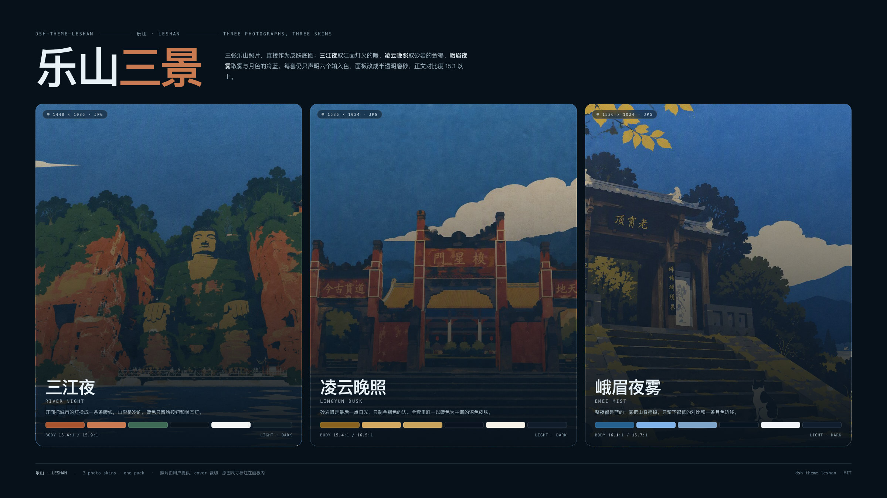
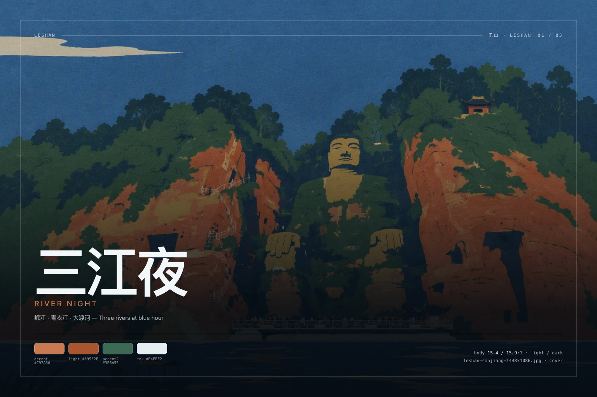

# dsh-theme-leshan

**Three photograph skins for the DeepSeek Harness Web GUI — River Night, Lingyun Dusk, Emei Mist. One token engine, light and dark, switched from inside the app.**

[中文说明](./README.zh.md) · [Theme document](./docs/themes.md) · [Palette reference](./docs/palettes.md) · [Image sizes](./docs/images.md)



Leshan is a small pack built around three photographs of 乐山: the rivers at blue hour, the Lingyun cliff at dusk, and Emei in night mist. Each photograph is the page; each skin declares six input colours per appearance; the engine derives the 119 `--dsw-*` alias tokens the Web shell reads from them, then measures the result. Three skins × two appearances = six palettes that all share the same semantic rules, so a state that reads in light mode reads in dark.

## The three skins

| Skin | Photograph | Accent light / dark | Body contrast | Preview |
| --- | --- | --- | --- | --- |
| **三江夜 River Night** | 岷江 · 青衣江 · 大渡河 / three rivers at blue hour | `#A9552F` / `#C97A50` | 15.4:1 / 15.9:1 | [light](./assets/screenshots/01-sanjiang-light-1600x1000.jpg) · [dark](./assets/screenshots/02-sanjiang-dark-1600x1000.jpg) |
| **凌云晚照 Lingyun Dusk** | 崖壁 · 晚钟 / cliff face at the evening bell | `#8A6320` / `#D3A961` | 15.4:1 / 16.5:1 | [light](./assets/screenshots/03-lingyun-light-1600x1000.jpg) · [dark](./assets/screenshots/04-lingyun-dark-1600x1000.jpg) |
| **峨眉夜雾 Emei Mist** | 冷雾 · 月色 / cold mist and moonlight | `#25618F` / `#7FB2E8` | 16.1:1 / 15.7:1 | [light](./assets/screenshots/05-emei-light-1600x1000.jpg) · [dark](./assets/screenshots/06-emei-dark-1600x1000.jpg) |

Full palettes, token tables and measured contrast live in [docs/palettes.md](./docs/palettes.md).

### 乐山 · Leshan



The three photographs are used at their native resolution and cover-cropped by the shell. The host half serves them from `/dsh-theme-leshan/wallpapers/<file>` through an exact-file whitelist (immutable caching, HEAD, 304); without a `webServer` service the skin falls back to a wash and stays fully usable.

| Skin | Photograph | Native size | Key art |
| --- | --- | --- | --- |
| 三江夜 River Night | `leshan-sanjiang-1448x1086.jpg` | 1448×1086 | [`assets/keyart/sanjiang-1536x1024.jpg`](./assets/keyart/sanjiang-1536x1024.jpg) |
| 凌云晚照 Lingyun Dusk | `leshan-lingyun-1536x1024.jpg` | 1536×1024 | [`assets/keyart/lingyun-1536x1024.jpg`](./assets/keyart/lingyun-1536x1024.jpg) |
| 峨眉夜雾 Emei Mist | `leshan-emei-1536x1024.jpg` | 1536×1024 | [`assets/keyart/emei-1536x1024.jpg`](./assets/keyart/emei-1536x1024.jpg) |

## Install

The package in this folder is already a loadable bundle, so a local install needs no registry:

```sh
# from the profile that runs the shell (desktop profile shown)
dsh plugin --profile desktop add /Users/johnsmacbook/Desktop/Program/deepseek/plugins/dsh-theme-leshan
```

Desktop app: **插件 → 添加插件**, paste the folder path above, enable it, then reload the window if the shell asks.

The plugin is a normal bundle: `package.json` declares `dsh.bundle` + a `cordis.patch.yml`, so `dsh plugin add` can load it. There is no build step to approve — `client.js` ships prebuilt.

## Switch skins

- Click the **Leshan** pill at the bottom-right of the window, or press <kbd>Alt</kbd>+<kbd>K</kbd> to cycle.
- The choice is browser-local (`localStorage: dsh.theme.leshan.skin`), so different browsers can run different skins.
- “隐藏此钮” hides the pill (`dsh.theme.leshan.rail`); <kbd>Alt</kbd>+<kbd>K</kbd> keeps working, and clearing that key brings the pill back.
- Light/dark still belongs to the shell’s own **Appearance** setting — Leshan has both palettes and never overrides your preference.

## What it actually does

1. **Token layer.** On load it calls `ctx.theme.overrideTokens('dsh-theme-leshan', layer)`, where `layer` maps every `--dsw-*` alias token to a `{ light, dark }` pair. Switching a skin replaces that layer; unloading the plugin removes it. On a shell without the theme service it falls back to a scoped stylesheet with the same values.
2. **Wallpaper sheet.** One small plugin-owned stylesheet paints the active photograph on `<body>` *and* on the conversation column (`[data-conversation-region="chat"]`, the shell's reading surface, which otherwise sits on an opaque page-colour plate) under the same appearance-keyed scrim (0.86 → 0.90 light, 0.74 → 0.82 dark), keyed by `html[data-dsh-leshan]` / `html[data-dsh-leshan-wallpaper]`. Both seats share the focus, the `fixed` attachment and the scrim, so the photograph runs unbroken from the sidebar into the chat column; the derived surface tokens carry alpha so the panels read as frosted plates. No layout is touched.
3. **Skin rail.** A shadow-DOM panel so no shell rule can reach it, keyboard reachable, removed with the plugin.

Nothing else is written: no host settings document, no files, no network calls.

## Images in this repo

| Set | Size | Count | Where |
| --- | --- | --- | --- |
| Storefront screenshots | 1600×1000 (16:10) | 6 | [`assets/screenshots/`](./assets/screenshots) |
| Triptych banner | 2400×1350 (16:9) | 1 | [`assets/screenshots/00-leshan-2400x1350.jpg`](./assets/screenshots/00-leshan-2400x1350.jpg) |
| Key art | 1536×1024 (3:2) | 3 | [`assets/keyart/`](./assets/keyart) |
| Wallpapers | native 1448×1086 / 1536×1024 | 3 | [`assets/wallpapers/`](./assets/wallpapers) |
| Storefront icon | 1024, 512, 180 square | 3 | [`assets/`](./assets) |

Sizes, display guidance and regeneration commands are specified in [docs/images.md](./docs/images.md); `screenshots.json` points the storefront at all seven UI shots.

The three supplied PNG originals (`gpt-image-*.png`) stay in the package root as the wallpaper masters; `npm run compress` re-derives `assets/wallpapers/*.jpg` from them at quality 80.

## Compatibility

- DeepSeek Harness Web **0.2.0-rc.1 … 0.2.x** (`dsh.bundle` + `dsh.client`).
- Works in the official Desktop app and in `dsh web`; needs a browser with `color-mix()` (Chromium 111+, Safari 16.2+).
- If the theme service is absent, the fallback layer still applies both palettes.

## Develop

```sh
npm install
npm run verify   # build + token completeness + WCAG gates
npm run shots    # re-render every image at the documented size
```

Source layout: `src/color.mjs` (colour maths), `src/tokens.mjs` (the 119-name contract), `src/skins.mjs` (three skins, six inputs per appearance plus one photograph), `src/derive.mjs` (role derivation, plus the translucent-plate mode for photo skins), `src/runtime.mjs` (tokens, wallpaper, rail), `index.js` (the wallpaper route). `client.js` is generated — edit `src/` and run `npm run build`.

Adding a skin is one row in `src/skins.mjs` plus one JPEG in `assets/wallpapers/` and one entry in `index.js`'s whitelist; run `npm run verify` and the contrast gate tells you whether the two new palettes hold up.

## License

MIT. Palette names and copy are original to this package; the `--dsw-*` token names belong to DeepSeek Harness.
