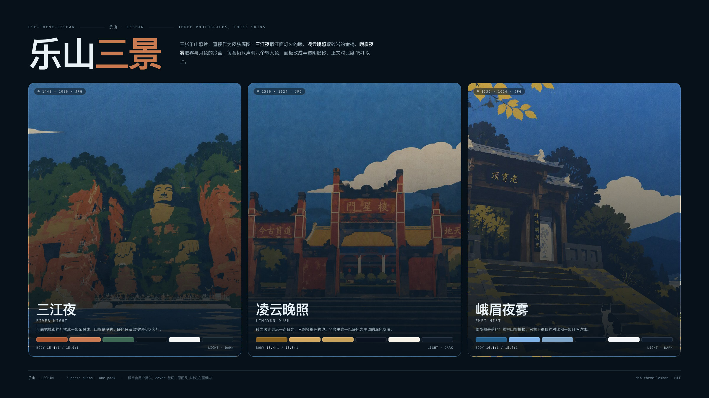
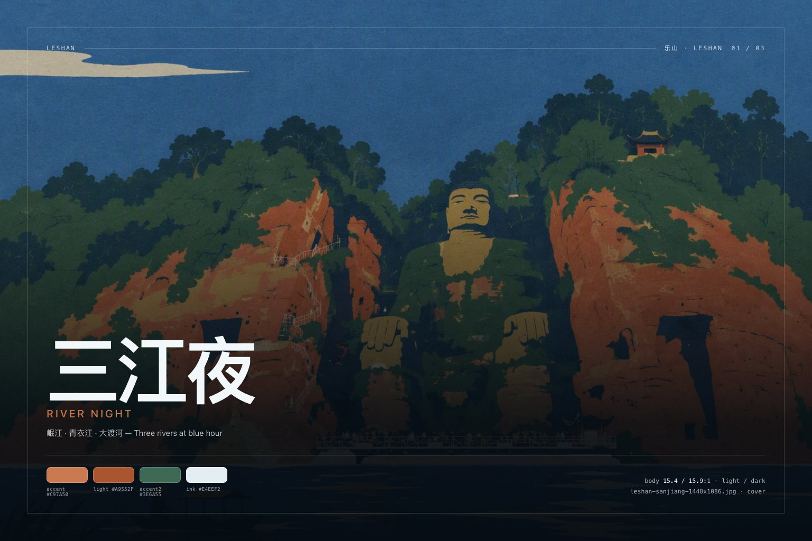

# dsh-theme-leshan

**DeepSeek Harness 网页端的三套照片皮肤：三江夜、凌云晚照、峨眉夜雾。一个 token 引擎，深浅双版，应用内切换。**

[English](./README.md) · [主题文档](./docs/themes.md) · [色板参考](./docs/palettes.md) · [图片尺寸](./docs/images.md)



乐山是一组以照片为主体的皮肤。三张乐山照片各自成为一页底图：江面蓝调时刻的三江、黄昏的凌云崖壁、夜雾里的峨眉。每套皮肤只声明六个输入色（每种外观各一组），引擎据此推导 Web 外壳读取的 119 个 `--dsw-*` 别名 token，再对结果做对比度测量。三套 × 深浅两版 = 六份色板，共用同一套语义：浅色下能看清的状态色，深色下同样成立。

## 三套皮肤

| 皮肤 | 照片 | 主色（浅 / 深） | 正文对比度 | 预览 |
| --- | --- | --- | --- | --- |
| **三江夜 River Night** | 岷江 · 青衣江 · 大渡河 | `#A9552F` / `#C97A50` | 15.4:1 / 15.9:1 | [浅色](./assets/screenshots/01-sanjiang-light-1600x1000.jpg) · [深色](./assets/screenshots/02-sanjiang-dark-1600x1000.jpg) |
| **凌云晚照 Lingyun Dusk** | 崖壁 · 晚钟 | `#8A6320` / `#D3A961` | 15.4:1 / 16.5:1 | [浅色](./assets/screenshots/03-lingyun-light-1600x1000.jpg) · [深色](./assets/screenshots/04-lingyun-dark-1600x1000.jpg) |
| **峨眉夜雾 Emei Mist** | 冷雾 · 月色 | `#25618F` / `#7FB2E8` | 16.1:1 / 15.7:1 | [浅色](./assets/screenshots/05-emei-light-1600x1000.jpg) · [深色](./assets/screenshots/06-emei-dark-1600x1000.jpg) |

完整色板、token 表与实测对比度见 [docs/palettes.md](./docs/palettes.md)。

### 乐山 · Leshan



三张照片按原始分辨率入包，由外壳 cover 裁切。宿主半边通过 `/dsh-theme-leshan/wallpapers/<file>` 精确白名单路由提供（不可变缓存、支持 HEAD、304 协商）；没有 `webServer` 服务时，皮肤退回氛围渐变，功能不受影响。

| 皮肤 | 照片文件 | 原始尺寸 | 主视觉 |
| --- | --- | --- | --- |
| 三江夜 River Night | `leshan-sanjiang-1448x1086.jpg` | 1448×1086 | [`assets/keyart/sanjiang-1536x1024.jpg`](./assets/keyart/sanjiang-1536x1024.jpg) |
| 凌云晚照 Lingyun Dusk | `leshan-lingyun-1536x1024.jpg` | 1536×1024 | [`assets/keyart/lingyun-1536x1024.jpg`](./assets/keyart/lingyun-1536x1024.jpg) |
| 峨眉夜雾 Emei Mist | `leshan-emei-1536x1024.jpg` | 1536×1024 | [`assets/keyart/emei-1536x1024.jpg`](./assets/keyart/emei-1536x1024.jpg) |

## 安装

```sh
# 预构建 tarball，免构建（推荐）
dsh plugin --profile desktop add https://github.com/John-20260101/dsh-theme-leshan/releases/latest/download/dsh-theme-leshan.tgz

# 或直接从 GitHub 源码安装
dsh plugin --profile desktop add github:John-20260101/dsh-theme-leshan

# 本地开发：这个目录本身就是可加载的 bundle
dsh plugin --profile desktop add /path/to/dsh-theme-leshan
```

桌面端：**插件 → 添加插件**，填入上面的地址或目录，启用后按提示刷新窗口。

这是一个标准 bundle：`package.json` 声明了 `dsh.bundle` 与 `cordis.patch.yml`，`dsh plugin add` 可以直接加载；`client.js` 已预构建，不需要构建授权。

## 切换皮肤

- 点击窗口右下角的 **Leshan** 胶囊，或按 <kbd>Alt</kbd>+<kbd>K</kbd> 轮换。
- 选择保存在浏览器本地（`localStorage: dsh.theme.leshan.skin`），不同浏览器可以各用一套。
- 「隐藏此钮」隐藏胶囊（`dsh.theme.leshan.rail`）；快捷键仍然可用，清掉该键即可恢复。
- 深浅模式仍由外壳自己的「外观」设置决定——乐山两套色板都在，不覆盖你的偏好。

## 它做了什么

1. **Token 层**：加载时调用 `ctx.theme.overrideTokens('dsh-theme-leshan', layer)`，把每个 `--dsw-*` 别名 token 映射为 `{ light, dark }` 一对值。换肤即替换这一层；卸载插件即移除。外壳没有主题服务时，退化为同值的局部样式表。
2. **壁纸层**：一张插件自有样式表，按 `html[data-dsh-leshan]` 把当前照片铺在 `<body>` 上，**并且**同样铺到对话栏 `[data-conversation-region="chat"]`（外壳的阅读区，原本被一层不透明的页面色挡住），按外观压同一层罩层（浅色 0.86 → 0.90，深色 0.74 → 0.82）。两处共用焦点、`fixed` 定位与罩层，所以照片从侧栏到对话区是连续的一张；推导出的 surface token 带 alpha，面板因此呈现磨砂质感。不碰任何布局。
3. **皮肤滑轨**：Shadow DOM 面板，外壳样式进不来，可键盘操作，随插件卸载一起移除。

除此之外不写任何东西：不写宿主设置、不落盘、不联网。

## 仓库里的图片

| 图片集 | 尺寸 | 数量 | 位置 |
| --- | --- | --- | --- |
| 商店截图 | 1600×1000（16:10） | 6 | [`assets/screenshots/`](./assets/screenshots) |
| 三景横幅 | 2400×1350（16:9） | 1 | [`assets/screenshots/00-leshan-2400x1350.jpg`](./assets/screenshots/00-leshan-2400x1350.jpg) |
| 主视觉 | 1536×1024（3:2） | 3 | [`assets/keyart/`](./assets/keyart) |
| 壁纸 | 原始 1448×1086 / 1536×1024 | 3 | [`assets/wallpapers/`](./assets/wallpapers) |
| 图标 | 1024 / 512 / 180 方形 | 3 | [`assets/`](./assets) |

尺寸规范、投放建议与重新生成的命令见 [docs/images.md](./docs/images.md)；`screenshots.json` 把商店位指向全部七张界面图。

三张原始 PNG（`gpt-image-*.png`）保留在包根目录作为壁纸母版；`npm run compress` 会按 q80 从母版重新生成 `assets/wallpapers/*.jpg`。

## 兼容性

- DeepSeek Harness Web **0.2.0-rc.1 … 0.2.x**（`dsh.bundle` + `dsh.client`）。
- 官方桌面端与 `dsh web` 均可；需要支持 `color-mix()` 的浏览器（Chromium 111+、Safari 16.2+）。
- 没有主题服务时，回退样式表仍会同时应用深浅两套色板。

## 开发

```sh
npm install
npm run verify   # 构建 + token 完整性 + WCAG 门槛
npm run shots    # 按文档尺寸重渲染全部图片
```

源码结构：`src/color.mjs`（颜色计算）、`src/tokens.mjs`（119 个 token 名契约）、`src/skins.mjs`（三套皮肤：每套六个输入色 + 一张照片）、`src/derive.mjs`（按角色推导，照片皮肤使用半透明面板模式）、`src/runtime.mjs`（token、壁纸、滑轨）、`index.js`（壁纸路由）。`client.js` 是生成物——改 `src/` 后运行 `npm run build`。

新增一套皮肤＝在 `src/skins.mjs` 加一行、在 `assets/wallpapers/` 放一张 JPEG、在 `index.js` 白名单加一个名字；`npm run verify` 的对比度门槛会告诉你新色板是否站得住。

## 许可

MIT。皮肤命名与文案属于本包；`--dsw-*` token 名属于 DeepSeek Harness。
